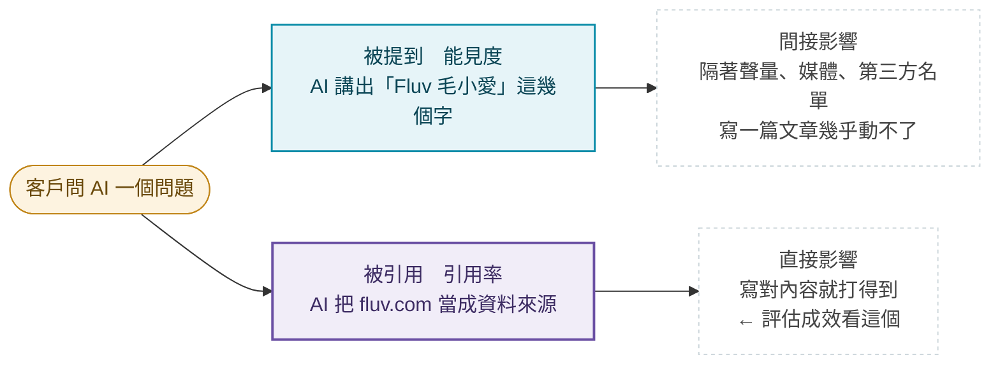

# Fluv GEO 監測平台

> 追蹤品牌「Fluv 毛小愛」在各家 AI 助理回答中的能見度與引用率。
> 內部自用工具 · Python ＋ SQLite ＋ Streamlit

**這個系統的產出是數字，而數字是唯一一種會安靜錯掉的東西。**
程式壞了會噴錯，數字錯了不會 —— 它照樣畫得漂漂亮亮，只是內容是假的。
所以這個專案大部分的設計不在「怎麼量」，在「怎麼讓量錯的時候有人發現」。

---

## 流程


<table>
<tr>
<td>🟥 <b>紅色</b></td><td>目前卡住 —— <code>collect.py</code> 等 API 金鑰、<code>parse.py</code> 刻意還沒寫（見下）</td>
</tr>
<tr>
<td>🟦 <b>藍色</b></td><td>可以跑</td>
</tr>
<tr>
<td>🟧 <b>橘色</b></td><td>人工，刻意不自動化</td>
</tr>
<tr>
<td>🟪 <b>紫色</b></td><td>只讀不寫</td>
</tr>
</table>

六步是一個閉環。第 6 步回到第 1 步，而「這次的數字跟上次比有沒有**真的**變化」
就是整個系統存在的理由。

### 兩個主指標要分開看



所以趨勢圖上的**行動標記線要配引用率**才看得出因果。

---

## 目前狀態

| 階段 | 內容 | 狀態 |
|---|---|---|
| 0 | 骨架：十張表、七頁畫面、示範資料 | ✅ 完成 |
| 1 | 真的問得到 AI：`collect.py` ＋ `read_runs.py` | 🟡 程式完成，等金鑰 |
| 2 | 判讀器：100 則人工盲測標記 → `parse.py` | 🔴 刻意未開始 |
| 3 | 指標與信賴區間：`aggregate.py` | ✅ 完成，引用率可人工驗算 |
| 4 | 缺口與行動：`gaps.py` | ✅ 完成 |
| 5 | 自動長大：`draft.py` ＋ `suggest.py` | 🟡 草稿完成，GSC 未接 |
| 6 | 網站健檢：`audit.py` | ⬜ 未開始（不需要 API） |

**為什麼階段 2 刻意不做：** 規範訂了順序 —— 先有標準答案，才能有判讀器。
要先人工**盲測**標記 100 則（標記的人不能知道哪個品牌是客戶，否則標準答案本身就帶偏了），
判讀器跟它的一致率 ≥ 90% 才准往下走。這是整個專案唯一真正的品質關卡。

**為什麼階段 1 卡住：** 各家的網路搜尋功能都要付費帳戶。
Gemini 原本有免費搜尋額度，但那個額度掛在**已下架**的 2.5 Flash 上，
現存模型的搜尋額度是 0。不開搜尋的話問到的是模型的記憶，不是查來的資料 ——
數字會看起來完全正常，但意義是錯的，所以寧可不跑。

---

## 三分鐘跑起來

需要 Python 3.9 以上。在專案根目錄依序執行：

```bash
pip install -r requirements.txt      # 只有三個套件：streamlit / pandas / plotly

python scripts/init_db.py            # 1. 建立資料庫與十張表
python scripts/seed_demo.py          # 2. 塞入示範資料
streamlit run scripts/app.py         # 3. 打開儀表板
```

第三行會印出一個網址（通常是 http://localhost:8501），
用瀏覽器打開就會看到七頁畫面，每一頁都有東西可以看。

**畫面上所有數字目前都是假的。** 每一頁右上角都標著「示範資料」。
假資料的用途是展示功能與版面，不是展示真實數據 —— 現在還沒有真題庫、也還沒有 API 金鑰，
這是正常的。階段 1 接上官方 API 之後就會換成真的。

---

## 階段 1 怎麼跑（真的去問 AI）

### 一、準備金鑰

```bash
# 只在 .env 還不存在時才建立 —— 加了 -n 就不會蓋掉已經填好的金鑰
cp -n .env.example .env
open -e .env             # 編輯它，填入金鑰
pip install -r requirements.txt
```

⚠️ **不要用 `cp .env.example .env`（沒有 `-n`）。**
那會用空白範本覆蓋掉現有的 `.env`，已經填好的金鑰會全部消失。
`-n` 的意思是「目標檔案已存在就不要動它」。

目前預設只跑 Gemini，所以只需要一把：`GEMINI_API_KEY`。
到 aistudio.google.com 申請，**不用綁信用卡**。
`.env` 已被 `.gitignore` 排除，不會進版控。

**為什麼先用 Gemini**（2026-09-21 決定）：它的免費額度包含 Google 搜尋
（Gemini 2.5 Flash，每天 500 次帶搜尋的請求），一週只需要 72 次，完全夠用。
可以先把整條路跑通、看看真實答案長什麼樣，不用先付錢。

**兩個要知道的代價：**

- 免費額度的資料會被 Google 拿去改進產品。問的是「台灣哪裡找寵物保母」這種公開問題，影響不大。
- Flash 是比較小的模型，答案不完全等於消費者用 ChatGPT／Claude 會看到的。
  適合驗證流程，**不適合當最終的正式數字** —— 正式量測還是要補上其他家。

其他三家的程式都寫好了，填入對應金鑰後加 `--engine` 就能跑，不用改程式：

```bash
python scripts/collect.py --engine gemini --engine anthropic
```

⚠️ **`MODELS` 裡的 Gemini 一定要維持 `gemini-2.5-flash`，不要改成 3.x。**
免費的搜尋功能只給 2.5 這一代，換掉的話搜尋會失效，
問到的變成模型的記憶 —— 數字看起來完全正常，意義卻是錯的。

### 二、按這個順序跑，不要跳過

```bash
python scripts/collect.py --dry-run      # 1. 先看會花多少錢
python scripts/collect.py --limit 1      # 2. 只試一題，確認接得通
python scripts/read_runs.py --latest 3   # 3. 把回答讀出來看
python scripts/read_runs.py --check      # 4. 健檢：web search 有沒有真的開
python scripts/collect.py                # 5. 都沒問題才跑完整一輪
```

**第 3、4 步不要跳過。** 這是唯一能發現「web search 沒開」的方法 ——
沒開的話 AI 回答的是它的記憶而不是查來的資料，畫面上的數字會完全正常，但意義是錯的。

### 三、花費控制

`collect.py` 有兩道煞車，兩道都預設開著：

| 保護 | 行為 |
|---|---|
| 開跑前 | 預估超過 `--max-cost`（預設 30 美金）就完全不跑 |
| 跑到一半 | 累計花費達到上限就停，已跑完的都保留 |

中斷之後直接重跑就好，已經有檔案的會自動跳過（`--resume` 預設開啟）。

**跑一次 = 一輪 = 每題每家各問一次。** 24 題 × 1 家 = 24 次呼叫，
四家都開的話是 24 × 4 = 96 次。

**要累積幾次回答，由你決定跑幾次** —— 不用改設定。
腳本會自動接續編號（第 1 次、第 2 次、第 3 次…），舊檔案永遠不會被蓋掉。

⚠️ **改 N 這件事本身要小心。** 樣本數變了，信賴區間的寬窄就會變，
跨週的「有沒有變化」判斷基準會不一致。要調的話盡量在開始累積趨勢之前調完。

### 為什麼要累積多次，而且要分開幾天跑

AI 每次回答都不一樣。同一題只問一次的話，提到就是 100%、沒提到就是 0% ——
那是擲硬幣，不是量測。累積多次才算得出「10 次裡有 6 次提到我們」這種有意義的數字。

**而且分幾天跑，比一天連問很多次好。**
一次連問的話，那幾次共享同一個時間點的搜尋環境（例如當天剛好有篇新聞洗版），
信賴區間會假性地變窄 —— 看起來「數字很穩定很可信」，其實只是同一個瞬間量了很多遍。
分散採樣量到的才是「這一週大概是多少」。

建議一週跑個 3～7 次，分散在不同天。想一次跑兩輪的話：`--samples 2`（少用）。

### 四、示範資料已經跟真資料分開了

資料庫裡原本那 1200 筆是 `seed_demo.py` 用亂數產生的示範資料，
2026-09-20 已經把它們的 `condition` 改標成 `demo`（沒有刪除，只是改標籤）。

所以之後：真實資料是 `condition=api`，示範資料是 `condition=demo`，
階段 3 的 `aggregate.py` 算指標時必須排除 `demo`，否則會把亂數混進真實數字裡。
這條提醒已經寫進 `aggregate.py` 的 TODO 裡。

要只看某一種：`python scripts/read_runs.py --condition demo --list`

### 五、每次跑完自動做的兩個檢查

1. **N 次回答是不是全都一樣** —— 全一樣代表採樣壞了（快取沒關），
   信賴區間會假性變窄，統計變成裝飾品。
2. **失敗筆數** —— 失敗的 `runs.error` 有值，算指標時會被排除在分母外，
   不會被當成「沒提到我們」而讓能見度憑空變低。

---

## 目前資料庫裡有什麼（2026-10-12）

| 量測條件 | 筆數 | 是什麼 | 哪些指標可信 |
|---|---|---|---|
| `manual-tally` | 80 | 九月基準測試：20 題 × 4 家，人工在網頁介面問 | 只有能見度；Claude 另有引用率 |
| `manual` | 16 | 九月手動蒐集：3 題 × 4 家，**有保留完整原文** | 能見度、引用率、SoV |
| `demo` | 1,200 | `seed_demo.py` 的亂數示範資料 | 全部不可信，算指標時排除 |
| `api` | 1 | 第一次 Gemini 測試（失敗） | — |

### 七月那批為什麼沒有匯進來

原始試算表裡有 7 月 8–9 日的同一批 20 題紀錄（提及率 60%），但**那次可能沒有用無痕模式**。
沒開無痕的話，AI 的回答會被操作者自己的瀏覽紀錄影響 ——
在 Fluv 工作的人天天看 fluv.com，個人化會把提及率墊高。

那樣的數字不能當基準，混進來會讓後面所有比較都偏，所以**刻意不匯入**。

### 題庫已凍結在「真的量過的 22 題」

階段 0 放的 22 題範例題（在辦公室想出來的問法）已經**停用**（不是刪除，設定頁可以改回來）。
留著它們的話，量到的是沒人問的問題，而且跨週比較會一直跳「題庫變動」的警告。

目前啟用的 22 題：20 題來自九月基準測試（真實問法）＋ `#14` 保險理賠 ＋ `#18` 平台比較。

⚠️ **代價是主題覆蓋變窄**：到府照顧 14 題、安親寄宿 7 題、陪伴散步 1 題，
洗澡美容現在是 0 題。要補覆蓋面的話，正確做法是**從 GSC 查詢字、站內搜尋、客服問題撈真實說法**，
不是再想幾題工整的句子出來。

### 不完整的資料一律留空，不給假數字

九月那批三個欄位的完整度差很多，所以 `aggregate.py` 會按實際完整度決定哪些算得出來：

| 欄位 | 完整度 | 處理 |
|---|---|---|
| 有沒有提到我們 | 80/80 | ✅ 能見度照算 |
| 提到哪些競品 | **4/80** | ❌ 競品不匯入，SoV 留空（硬算會變成 100%） |
| 引用來源 | 只有 Claude | 🟡 只有 Claude 的引用率算得出來，整體留空 |

畫面上會顯示「未計算」並說明原因，而不是給一個 0%。

---

## 算指標（階段 3）

資料進來之後，跑這一行把指標算出來：

```bash
python scripts/aggregate.py
```

它會從 `runs` ＋ `mentions` ＋ `citations` 重算 `metrics_weekly`，
然後總覽頁的數字就會更新。**每次有新資料就要重跑一次。**

兩個排除條件是寫死的，因為漏掉的話數字會安靜錯掉：

| 排除什麼 | 為什麼 |
|---|---|
| `condition='demo'` | 那是 `seed_demo.py` 的亂數。混進去的話趨勢圖一半是骰子擲出來的 |
| `error` 有值的 run | 呼叫失敗不算進分母。失敗被當成「沒提到我們」會讓能見度憑空變低 |

### 怎麼自己驗算（階段 3 的驗收條件）

```bash
python scripts/aggregate.py --verify 2026-W39
```

它會把那一週的每一則回答攤成一列，然後把能見度和**引用率**的分子分母印出來，
你可以拿計算機自己算一遍對答案。

引用率特別重要，因為它是後面所有內容行動的成效依據 —— 算錯的話整條歸因鏈都是假的。

想看信賴區間怎麼算的（不需要資料庫）：

```bash
python scripts/aggregate.py --explain 62 100
```

---

## 盤點缺口（階段 4）

```bash
python scripts/gaps.py --preview          # 先看會產出什麼，不寫進資料庫
python scripts/gaps.py --preview --detail  # 連完整說明一起看
python scripts/gaps.py                     # 寫入 gaps 表
```

缺口的單位是「主題 × 意圖」，例如「安親寄宿 × 緊急需求」。
每一筆都會算出機會分數，而且把算式寫在說明裡讓人驗算：

```
1.69 = (3 題 × 意圖權重 1.5 × 缺席程度 0.75) ÷ 難度 2
```

### 一個缺口要成立，必須「這題會點名品牌，只是沒點到我們」

如果 AI 回某一題時連競品都不提（整段只在講服務類型），那**不是內容缺口** ——
寫再多文章也不會被提到。所以每筆缺口都會標上競品對照的結果：

| 標記 | 意思 | 該怎麼辦 |
|---|---|---|
| ✅ 已確認 | 競品有出現、我們沒有 | 內容補得起來，可以投入 |
| ⚠️ 可能不是缺口 | 連競品都沒出現 | 先確認這題會不會點名平台，再決定 |
| ❓ 無法驗證 | 這批資料沒記錄競品 | 先調一題原文出來讀，確認是哪一種 |

### 關於 `holdout`（刻意不處理的對照組）

這支腳本產出的缺口一律是 `open`。`holdout` 只能由人在「機會建議」頁手動改。

重跑 `gaps.py` **只會更新分數與說明，不會動 `status`** ——
你把某個缺口改成 `in_progress` 或 `holdout` 之後，重跑不會被蓋掉。

---

## 寫草稿（階段 5）

```bash
python scripts/draft.py --list                # 有哪些缺口可以寫
python scripts/draft.py --gap 7 --preview     # 看會產出什麼
python scripts/draft.py --gap 7               # 寫進 drafts 表
python scripts/draft.py --check 我的文章.md     # 拿四條規則檢查一篇現成文章
```

### ⚠️ 這支腳本不會幫你寫出成稿

它產出的是**標題 ＋ 大綱 ＋ 骨架 ＋ 要填哪些事實**，不是可以直接發佈的散文。

原因：四條規則裡最硬的一條是「事實密度高、有具體數字」，
而那些數字（價格區間、理賠上限、驗證流程）在 Fluv 手上，不在程式手上。
自動生成一篇沒有數字的漂亮文章，正好違反它要遵守的規則。

它會做的是：
- 標題直接用客戶真的會打的那句問句（規則第一條）
- 每個小標底下標明「這裡需要哪一種事實」
- **從已經存下來的 AI 回答裡撈出 AI 已經知道的 Fluv 事實**當素材
  （例如自負額 NT$3,000、醫療補助上限 NT$15,000、通報期限 3 天）
- 跑完四條規則，告訴你還差什麼

撈事實時會**排除提到競品的句子** —— 不然會把 PetBacker 的理賠條件誤抄成我們的。
抄錯數字比沒有數字更糟。撈出來的每一個數字發佈前都要跟官網條款核對。

### 四條寫作規則（`writing_rules.py`）

目標不是 Google 排名，是「被 AI 當成資料來源引用」：

| 規則 | 為什麼 |
|---|---|
| 一個標題 = 一個明確問題 | AI 要回答某個問題時，會找標題就是那個問題的頁面 |
| 答案放在段落開頭，可獨立擷取 | 模型擷取的是一小段能獨立成立的文字。答案埋在第五段就擷取不到 |
| 事實密度高、有具體數字 | 「費用依服務型態而定」不會被引用，「一次 400–800 元」會 |
| 避免行銷形容詞 | 模型不引用形容詞。而且形容詞多會被判定成廣告，降低整頁可信度 |

這四條寫在 `writing_rules.py`，**階段 6 的 `audit.py` 會拿同一份去掃已上線的頁面** ——
寫成一份共用，不是各寫一次，因為兩份規則遲早會不一致（CLAUDE.md 的要求）。

**永遠不自動發佈。** 產出一律 `status='draft'`，等人審核。

---

## 備份 data/（它不在版控裡）

```bash
python scripts/backup.py                       # 打包到 backups/
python scripts/backup.py --list                # 看有哪些備份
python scripts/backup.py --verify <備份檔>       # 確認那份解得開、內容完整
```

`data/` 被 `.gitignore` 排除，所以 `git push` 不會保護到它。
而它是整個專案唯一不可重建的資產 —— 程式壞了可以重寫，原始回答刪了就沒了。

**做完備份一定要跑一次 `--verify`。** 備份最糟的失敗方式是
「以為有備份，要用的時候才發現解不開」。

⚠️ **備份在同一顆硬碟上，只能防手殘刪掉，不能防硬碟壞掉。**
打包完要再複製一份到 Google Drive 或隨身碟。

### 目前的資料其實大多可以重建

| 來源 | 筆數 | 萬一遺失 |
|---|---|---|
| `seed_demo.py` 的亂數 | 1,200 | ✅ 重跑 `seed_demo.py` |
| 九月基準測試試算表 | 80 | ✅ 試算表還在 Google Drive |
| 兩份 Google 文件 | 16 | ✅ 文件還在 Google Drive |

**所以現在備份的急迫性沒那麼高。**
但等 `collect.py` 透過 API 真的跑起來之後，那些回答就會變成**世界上唯一一份** ——
AI 的回答每次都不同，同一題再問一次得到的不會是同一個答案。
那時候每跑完一輪就該備份一次。

---

## 七頁畫面

| 頁 | 看什麼 |
|---|---|
| **總覽** | 四個 KPI、能見度趨勢（含信賴區間陰影與行動標記線）、口氣比例趨勢、各引擎表現、競品比較、重點洞察 |
| **Prompt 監測** | 每一題的表現；點一列可以看那一題的**完整原始回答**，判定依據會用黃色標出來 |
| **受眾主題** | 主題 × 品牌的表現矩陣，找出我們在哪類問題上被蓋過去 |
| **競品比較** | SoV、平均排序、情緒分布，以及各品牌出現時 AI 引用了哪些來源 |
| **來源分析** | 引用次數、來源影響力排名、來源類型分布，含「機會等級」（引用競品但沒引用我們＝高機會） |
| **機會建議** | 依機會分數排序的缺口、四張渠道行動卡、預期成效、草稿 |
| **設定** | 題庫管理（可上傳 CSV，也可直接在畫面上編輯）、題目建議佇列、競品名單、採樣設定 |

每一頁頂端都固定顯示一條量測條件列：

```
N=10 · condition=api · locale=tw · 上次跑批 2026-08-31 03:22:10
```

理由：任何人看到「能見度 43%」都會問「這數字怎麼來的」。有這行就不用每次解釋。

---

## 十支腳本 ＋ 一個共用模組

跑任何一支都可以加 `--help` 看說明。

| 腳本 | 現在能做什麼 | 吃 → 做 → 吐 |
|---|---|---|
| `init_db.py` | ✅ 可用 | 無 → 建立十張表 → `data/geo.db` |
| `seed_demo.py` | ✅ 可用 | 空資料庫 → 產生假資料 → 十張表都有東西 |
| `app.py` | ✅ 可用 | 全部的表 → 七頁畫面 |
| `collect.py` | ✅ 可用 | 題庫 → 每題×每引擎跑 N 次 → 原文存 gzip、metadata 進 `runs` |
| `read_runs.py` | ✅ 可用 | `runs` ＋ gzip 原始檔 → 把原文印出來給人讀（只讀不寫） |
| `backup.py` | ✅ 可用 | `data/` → 一個 `.tar.gz` 備份檔（含驗證功能） |
| `parse.py` | 🔧 空殼（階段 2） | 原文 → 便宜模型逐則判讀 → `mentions`／`citations`／`domains` |
| `aggregate.py` | ✅ 可用 | 判讀結果 → 算指標與信賴區間 → `metrics_weekly` |
| `gaps.py` | ✅ 可用 | 指標 → 找缺席題目群、算機會分數 → `gaps` |
| `suggest.py` | 🔧 空殼（階段 5） | GSC＋站內搜尋＋回答中的新概念 → `prompt_suggestions` |
| `draft.py` | ✅ 可用 | 一個 gap ＋ 證據 → 標題／大綱／骨架 ＋ 規則檢查 → `drafts` |
| `writing_rules.py` | ✅ 可用 | **共用模組**（不是腳本）：四條寫作規則的檢查函式，`draft.py` 與階段 6 的 `audit.py` 共用同一份 |

「空殼」的意思是：跑得起來、有完整的參數與中文說明，但實際邏輯還沒寫，
執行後會印出一連串 `TODO:` 告訴你那一步將來會做什麼。

想看信賴區間怎麼算的，可以跑這個（不需要資料庫）：

```bash
python scripts/aggregate.py --explain 62 100
```

---

## 三條不可違反的規則

### 1. 統計顯著性必須顯示

AI 每次回答都不同，所以每個數字本身都有誤差。
「能見度 43%」的真正意思是「問了 500 次，其中 215 次提到我們」，
再問 500 次可能就變成 40% 或 46%，但品牌其實什麼都沒變。

所以：

- 所有比例都算 Wilson score interval（信賴區間）
- **畫面上，當變化落在信賴區間內時，一律顯示中性的「持平」，
  不可以顯示成紅色的「下降」或綠色的「上升」**

防止使用者對隨機波動做出反應，針對不存在的問題浪費資源。

程式碼在 `scripts/aggregate.py` 的 `wilson_interval()`，
畫面上的判斷在 `scripts/app.py` 的 `compare_proportions()`。

### 2. 原始回答不可變

- `data/raw/` 底下的檔案一旦寫入，**永不修改、永不刪除**
- 判讀邏輯改了，就拿原始檔案整批重跑，歷史數字全部重算
- 資料庫裡只存檔案路徑，不存回答全文

路徑格式：`data/raw/{年}/W{週}/{引擎}/{prompt_id}_{locale}_{sample_index}.json.gz`

理由：程式碼是耗材，原始資料是資產。

### 3. 量測條件必須顯示在畫面上

每一頁頂端固定一條量測條件列（見上）。

---

## 資料模型（十張表）

| 表 | 用途 | 誰維護 |
|---|---|---|
| `prompts` | 題庫 | 人 |
| `prompt_suggestions` | 題目建議佇列 | 系統提議 |
| `runs` | 每次提問的紀錄 | 自動 |
| `mentions` | 判讀結果：提及、排名、情緒 | 自動 |
| `citations` | 引用來源 | 自動 |
| `domains` | 網域清單與分類 | 自動 |
| `metrics_weekly` | 每週彙總指標＋信賴區間 | 自動 |
| `gaps` | 內容缺口＋機會分數 | 系統提議，人決定 |
| `actions` | 採取過的行動 | 人 |
| `drafts` | 文章草稿 | 系統產生，人審 |

想看目前各表有幾筆：

```bash
python scripts/init_db.py --show
```

**注意 `gaps.status` 的 `holdout`** —— 這是「刻意不處理的對照組」，是正式狀態，
不是備註。用途是日後比較「有行動」與「刻意不行動」兩組的變化幅度，
藉此區分數字變好是我們的功勞、還是模型自己在漂移。

---

## 資料從哪裡來

三個來源，只有第一項和第三項需要人操作：

1. **題庫** —— 人提供。在「設定」頁上傳 CSV，或直接在畫面上新增／編輯／停用。
2. **AI 回應** —— 系統自動抓（`collect.py`）。使用者不需要手動提供任何回應資料。
3. **行動紀錄** —— 人登記。發完文、聯絡完媒體之後在「機會建議」頁登記一筆。

其餘所有資料都是從上面三項算出來的。

### CSV 匯入格式

「設定 → 題庫管理」有「下載 CSV 範本」按鈕。欄位：

| 欄位 | 必填 | 說明 |
|---|---|---|
| `text` | ✅ | 題目全文 |
| `topic` | | 主題分類，留空會變「未分類」 |
| `intent` | | `discovery` / `comparison` / `price` / `trust` / `urgent` / `logistics` |
| `intent_weight` | | 留空會自動帶入該意圖的預設權重 |
| `locale` | | 預設 `tw` |
| `active` | | `1`＝納入跑批，`0`＝停用 |

跟現有題目文字重複的會自動跳過，不合法的意圖會被擋下來並告訴你是第幾行。

---

## 資料夾結構

```
geo-platform/
├── CLAUDE.md              專案規格（做什麼、不可違反的規則、建置順序）
├── README.md              這份文件
├── requirements.txt
├── .env.example           API 金鑰範本（複製成 .env 再填）
├── .gitignore             排除 .env 和 data/
├── scripts/
│   ├── common.py          共用小工具與固定值
│   ├── init_db.py         建表
│   ├── seed_demo.py       示範資料
│   ├── collect.py         蒐集（空殼）
│   ├── parse.py           判讀（空殼）
│   ├── aggregate.py       彙總＋信賴區間（空殼，但區間函式可用）
│   ├── gaps.py            缺口（空殼，但公式可用）
│   ├── suggest.py         題目建議（空殼）
│   ├── draft.py           草稿（空殼）
│   └── app.py             七頁儀表板
├── eval/                  階段 2 的人工標記答案會放這裡
└── data/                  ⛔ 不進版控
    ├── geo.db             SQLite 資料庫
    └── raw/               原始回答（gzip，永不修改）
```

---

## 接下來的階段

| 階段 | 內容 | 驗收 |
|---|---|---|
| ~~0 骨架~~ | ~~十張表、七支空殼、七頁版面、假資料~~ | ✅ 完成 |
| 1 真的問得到 AI | `collect.py` 接 OpenAI／Anthropic／Perplexity ＋ `read_runs.py` | 🔧 程式完成，等填金鑰後跑一輪驗收 |
| 2 判讀器 | **先人工標記 100 則**，才寫 `parse.py` | 與人工標記一致率 ≥ 90% |
| 3 指標 | `aggregate.py` ＋ Google AI Overviews | ✅ `aggregate.py` 完成、引用率可人工驗算（`--verify`）；SerpApi 未接 |
| 4 缺口與行動 | `gaps.py` ＋ 行動登記介面 | 🔧 `gaps.py` 完成；行動登記介面已在「機會建議」頁 |
| 5 自動長大 | `suggest.py`（接 GSC）＋ `draft.py` | 🔧 `draft.py` ＋ 寫作規則完成；`suggest.py` 還沒接 GSC |

⚠️ **階段 2 的順序不可以顛倒：先有標準答案，再有判讀器。**
判讀器是整個系統唯一真正的品質關卡，也是最容易「安靜出錯」的地方 ——
它不會壞、不會報錯，就是默默判錯一成多，而不會有人發現，
因為沒有人會去讀那幾千則原文。

---

## 遇到問題

**`找不到資料庫檔案` / 畫面顯示要先跑 init_db**
→ 依照「三分鐘跑起來」的順序執行前兩行。

**`seed_demo.py` 說「資料庫裡已經有資料」**
→ 這是保護機制，怕蓋掉你自己加的題目。確定要重塞就加 `--force`。

**想把示範資料整個清掉重來**
```bash
rm -rf data/            # 資料庫和原始檔案都會消失
python scripts/init_db.py
```

**改了程式但畫面沒變**
→ 瀏覽器右上角選單按 Rerun，或直接重新整理。

**畫面上的數字看起來怪怪的**
→ 現在全部都是假的。等階段 1 接上真 API 才會有意義。

---

## 技術限制（不要違反）

- Python + SQLite + Streamlit
- ❌ 不用 ORM（直接寫 `sqlite3`）、不用 vector database、不用 Docker、不用微服務
- ❌ **絕對不爬 AI 產品的網頁介面**（ToS 風險）—— 只用官方 API ＋ SerpApi
- ✅ 呼叫 OpenAI／Anthropic／Gemini 時**務必開啟各自的 web search 工具**
  （不開的話問到的是「裸模型的記憶」，不是會查資料的助理）
- ✅ `.gitignore` 必須排除 `.env` 和 `data/`

這是內部自用工具，不是要對外賣的產品。保持簡單。
